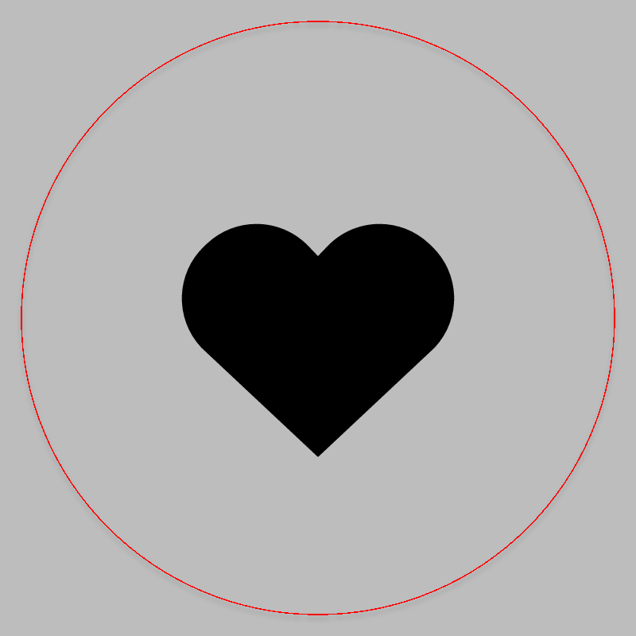
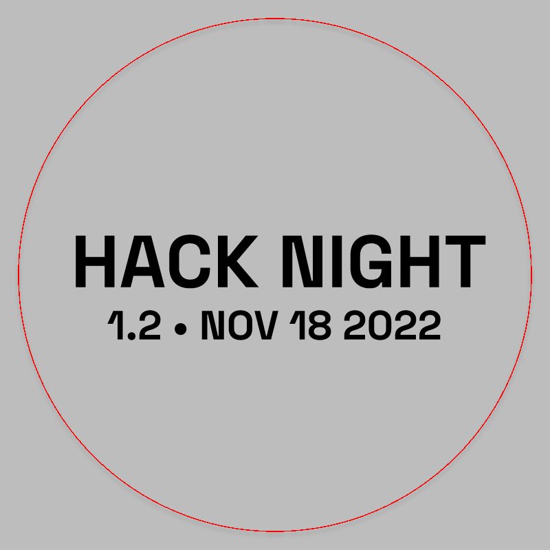

# Hack Night 1.2

CMS event: `133` · slug `1.2`.

Two badge faces are preserved as badge.svg and badge-back.svg. The back face is not a stamp.

A separate stamp was not identified.

## Badge

[Download SVG](badge.svg)

## Badge back

[Download SVG](badge-back.svg)

The gray preview background is for visibility and is not part of the SVG. Historical artwork may require corrections before manufacturing. A null reviewer means final approval could not be established.
