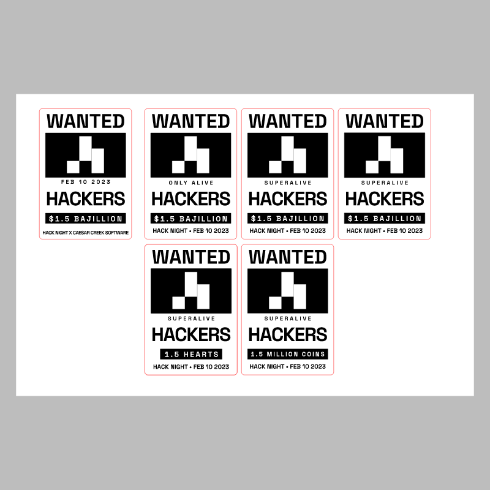

# Hack Night 1.5

CMS event: `49` · slug `1.5`.

The available sheet contains several wanted-poster designs. The final selection is unconfirmed; the whole set is preserved under variants/.

A separate stamp was not identified.

## Variant: badge sheet

[Download SVG](variants/badge-sheet.svg)

The gray preview background is for visibility and is not part of the SVG. Historical artwork may require corrections before manufacturing. A null reviewer means final approval could not be established.
