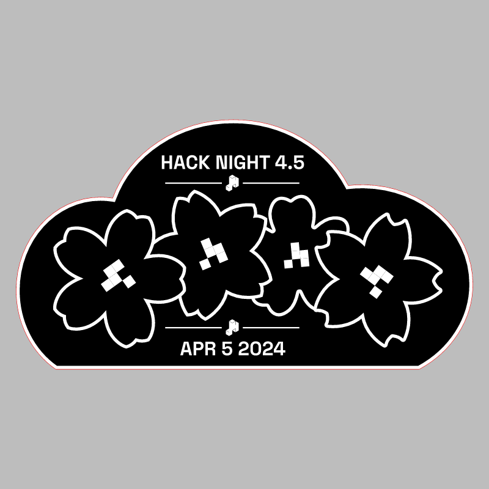
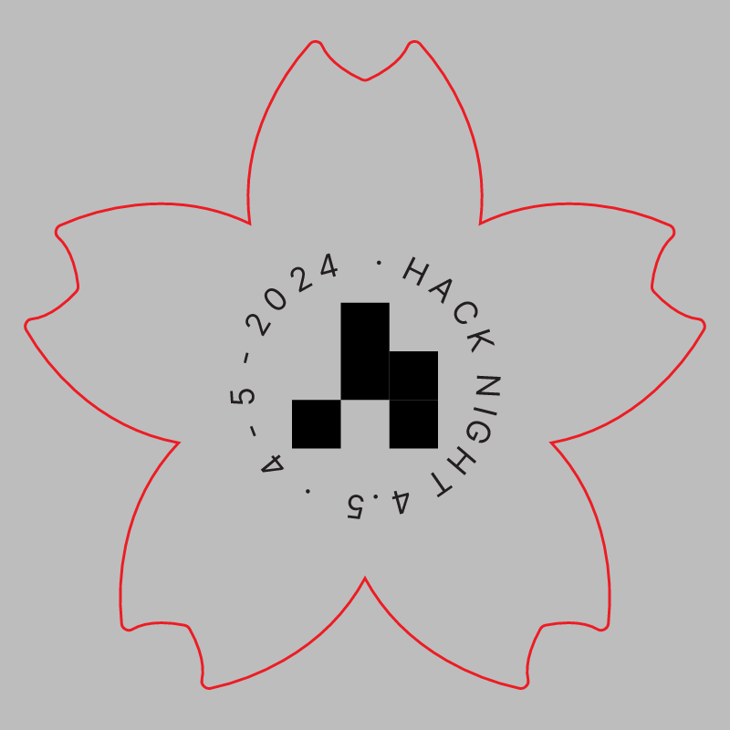
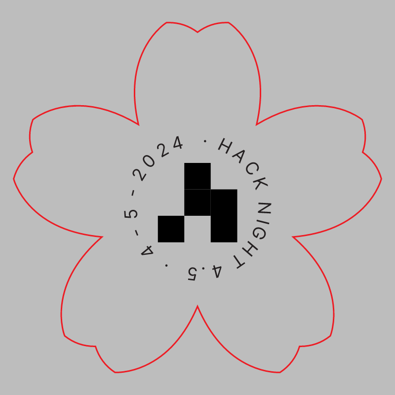
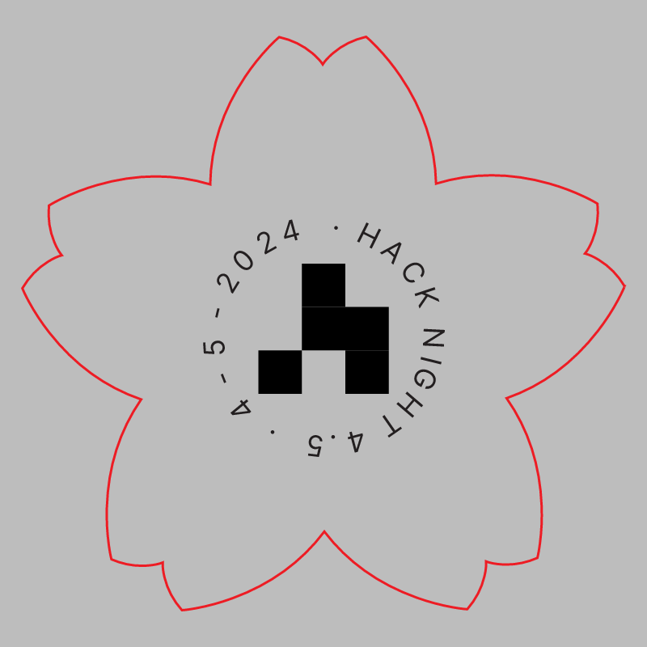
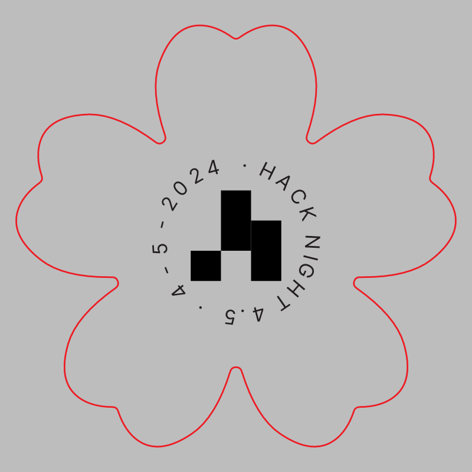

# Hack Night 4.5

CMS event: `69` · slug `4.5`.

Multiple designs or inversions survive. They are preserved under variants/; a single final badge has not been designated.

## Stamp

[Download SVG](stamp.svg)

## Variant: badge 1

[Download SVG](variants/badge-1.svg)

## Variant: badge 2

[Download SVG](variants/badge-2.svg)

## Variant: badge 3

[Download SVG](variants/badge-3.svg)

## Variant: badge 4

[Download SVG](variants/badge-4.svg)

The gray preview background is for visibility and is not part of the SVG. Historical artwork may require corrections before manufacturing. A null reviewer means final approval could not be established.
