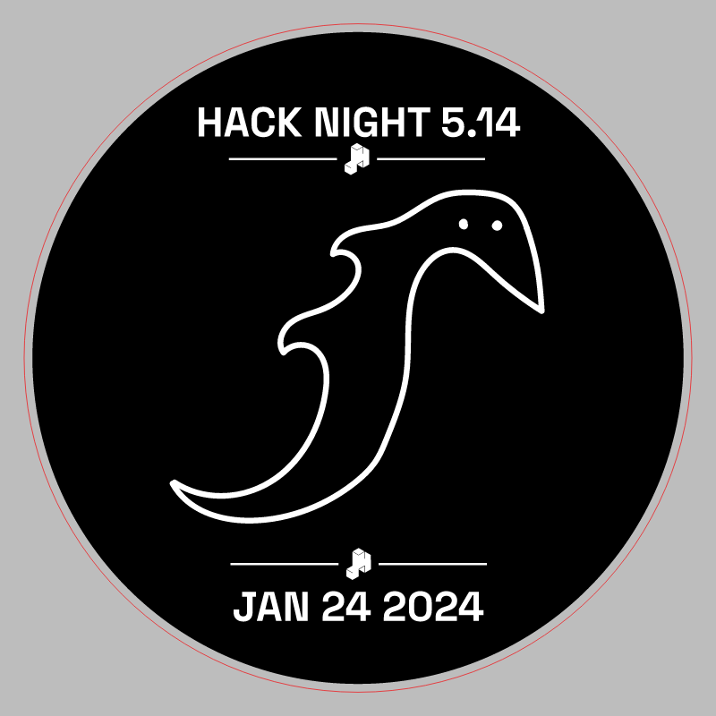
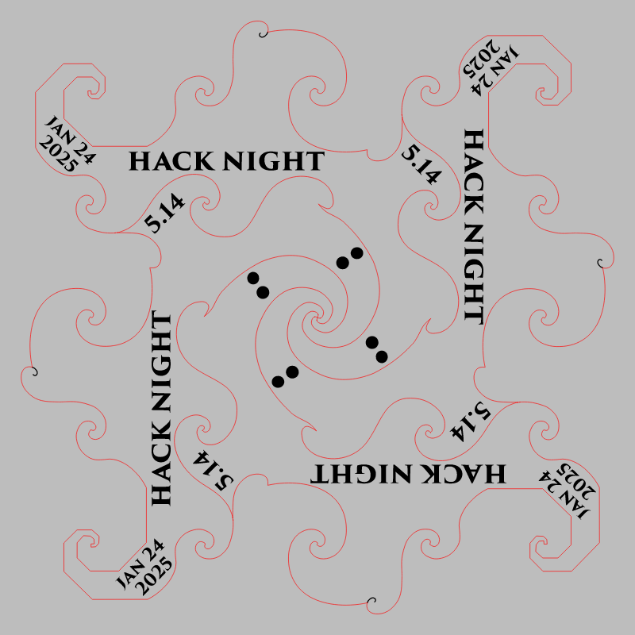

# Hack Night 5.14

CMS event: `20` · slug `5.14`.

The badge file is a four-dolphin cutting layout, preserved as cutting-sheet.svg. The stamp prints 2024 although the CMS event is in 2025. Historical labels are preserved.

## Stamp

[Download SVG](stamp.svg)

## Cutting sheet

[Download SVG](cutting-sheet.svg)

The gray preview background is for visibility and is not part of the SVG. Historical artwork may require corrections before manufacturing. A null reviewer means final approval could not be established.
