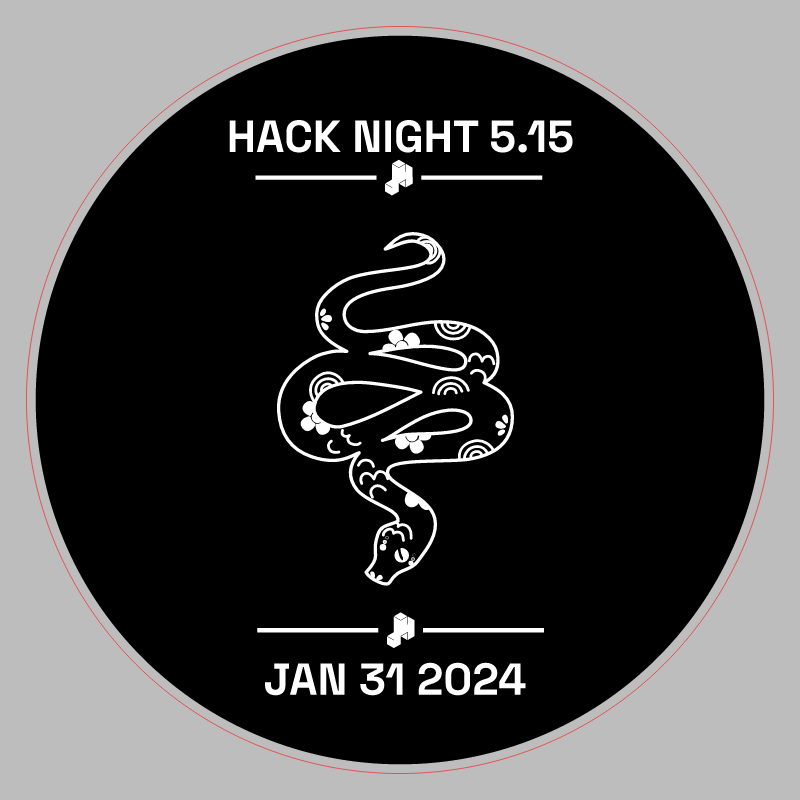
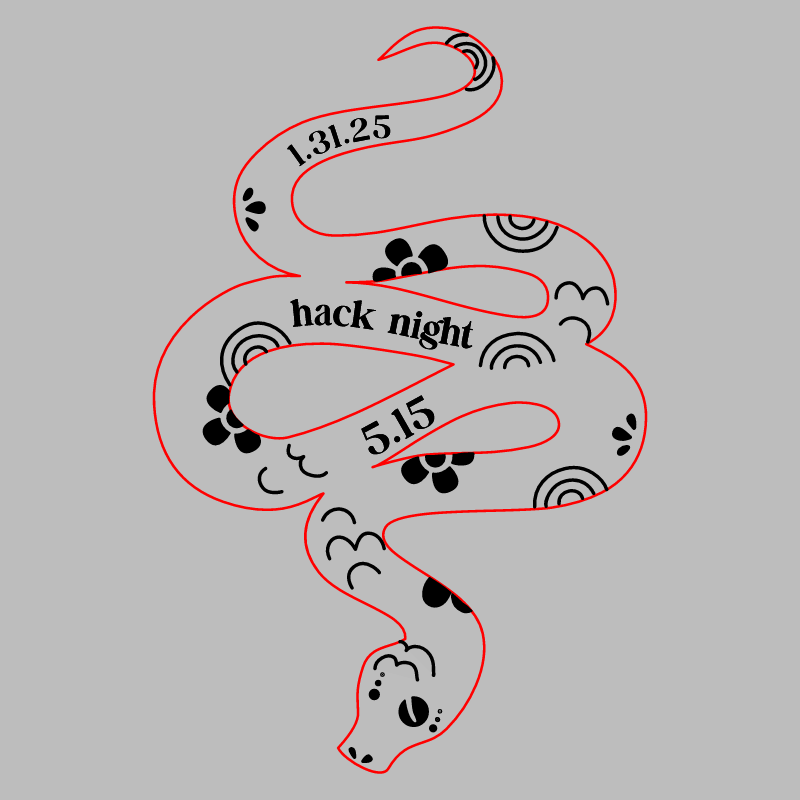
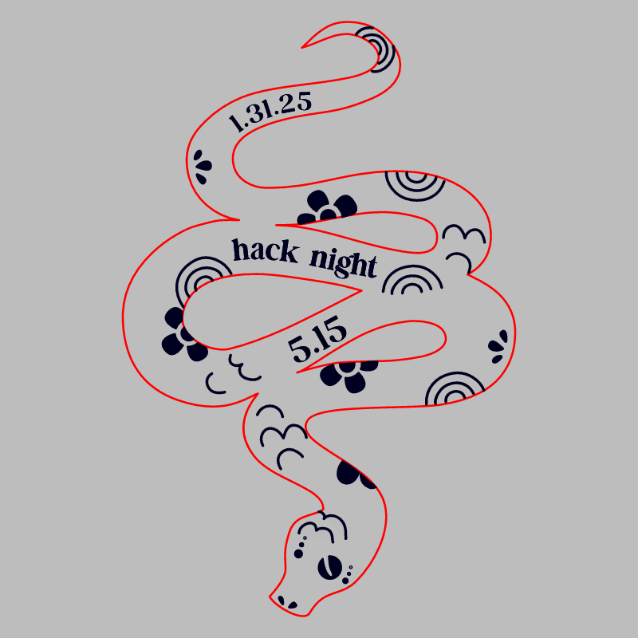

# Hack Night 5.15

CMS event: `16` · slug `5.15`.

Two badge inversions survive; both are under variants/. The stamp prints 2024 although the CMS event is in 2025. Historical labels are preserved.

## Stamp

[Download SVG](stamp.svg)

## Variant: badge 1

[Download SVG](variants/badge-1.svg)

## Variant: badge 2

[Download SVG](variants/badge-2.svg)

The gray preview background is for visibility and is not part of the SVG. Historical artwork may require corrections before manufacturing. A null reviewer means final approval could not be established.
