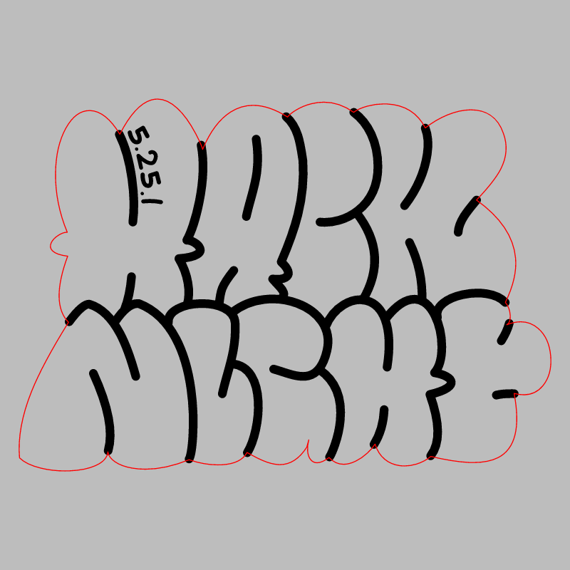
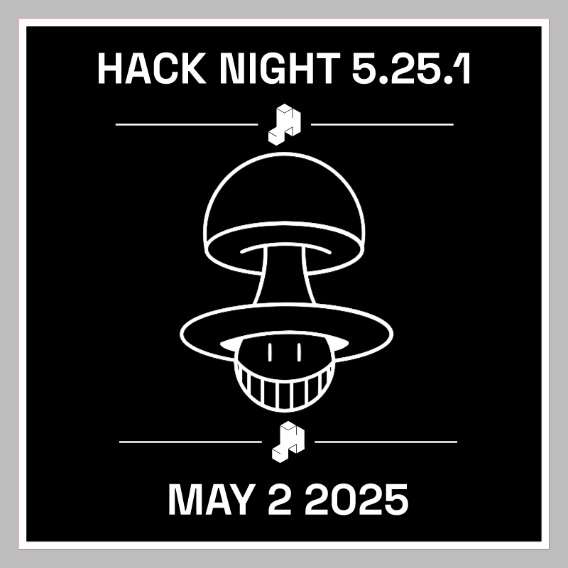

# Hack Night 5.25.1

CMS event: `98` · slug `5.25.1`.

The stamp SVG contains an embedded raster image, preserved from the historical artwork.

## Badge

[Download SVG](badge.svg)

## Stamp

[Download SVG](stamp.svg)

The gray preview background is for visibility and is not part of the SVG. Historical artwork may require corrections before manufacturing. A null reviewer means final approval could not be established.
