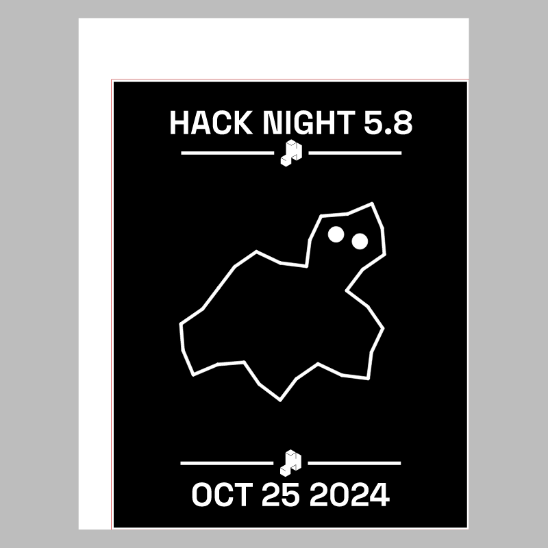
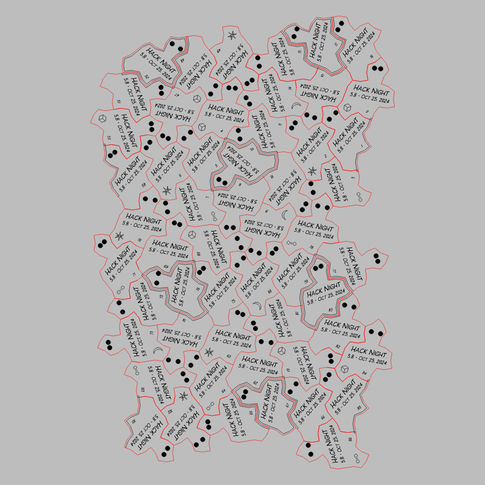

# Hack Night 5.8

CMS event: `35` · slug `5.8`.

The recovered badge file is a repeated ghost cutting layout. It is stored as cutting-sheet.svg rather than being presented as one badge.

## Stamp

[Download SVG](stamp.svg)

## Cutting sheet

[Download SVG](cutting-sheet.svg)

The gray preview background is for visibility and is not part of the SVG. Historical artwork may require corrections before manufacturing. A null reviewer means final approval could not be established.
