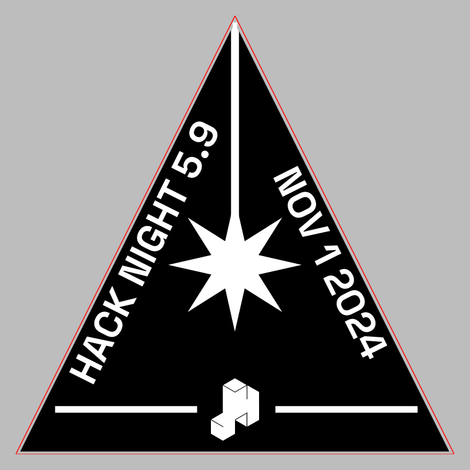

# Hack Night 5.9

CMS event: `33` · slug `5.9`.

One design was recovered, but its badge/stamp role is unconfirmed. It is preserved as unclassified.svg.

A separate stamp was not identified.

## Unclassified

[Download SVG](unclassified.svg)

The gray preview background is for visibility and is not part of the SVG. Historical artwork may require corrections before manufacturing. A null reviewer means final approval could not be established.
