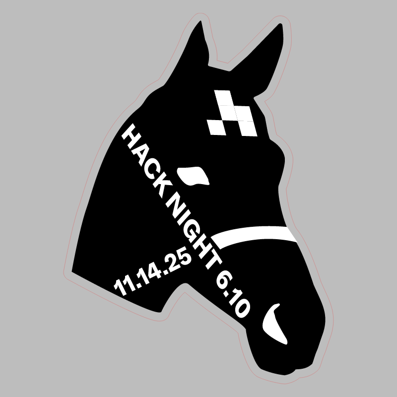
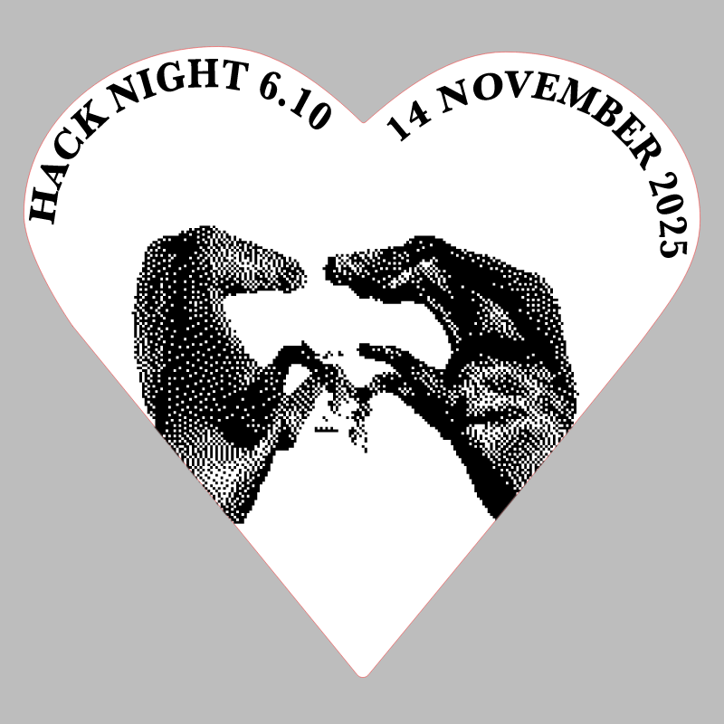

# Hack Night 6.10

CMS event: `156` · slug `6.10`.

An unrelated canvas comment was removed from the badge export. The stamp contains an embedded raster image. Its printed date is November 14, matching the CMS event.

## Badge

[Download SVG](badge.svg)

## Stamp

[Download SVG](stamp.svg)

The gray preview background is for visibility and is not part of the SVG. Historical artwork may require corrections before manufacturing. A null reviewer means final approval could not be established.
