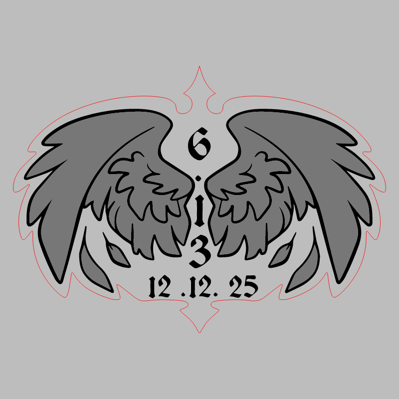
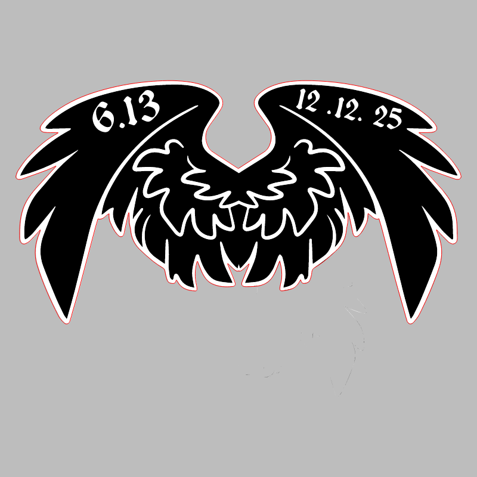

# Hack Night 6.13

CMS event: `160` · slug `6.13`.

The badge was a collaboration: melancholyseabiscuit supplied the design, cynthia_clementine vectorized it, and firefoxofficial made the stamp. The singular author field is left null rather than assigning the whole pair to one contributor.

## Badge

[Download SVG](badge.svg)

## Stamp

[Download SVG](stamp.svg)

The gray preview background is for visibility and is not part of the SVG. Historical artwork may require corrections before manufacturing. A null reviewer means final approval could not be established.
