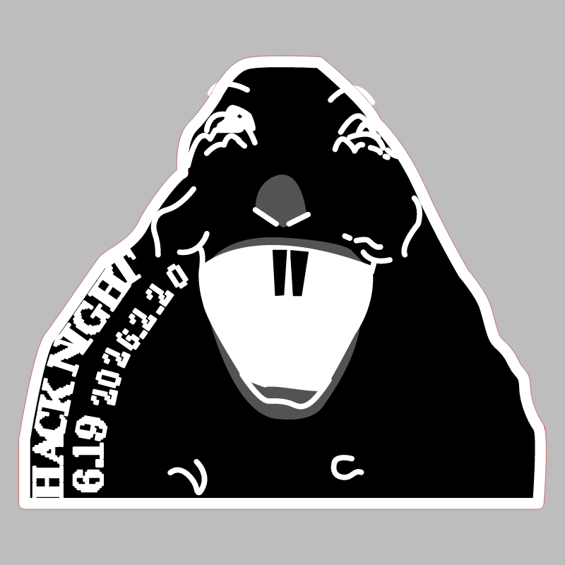
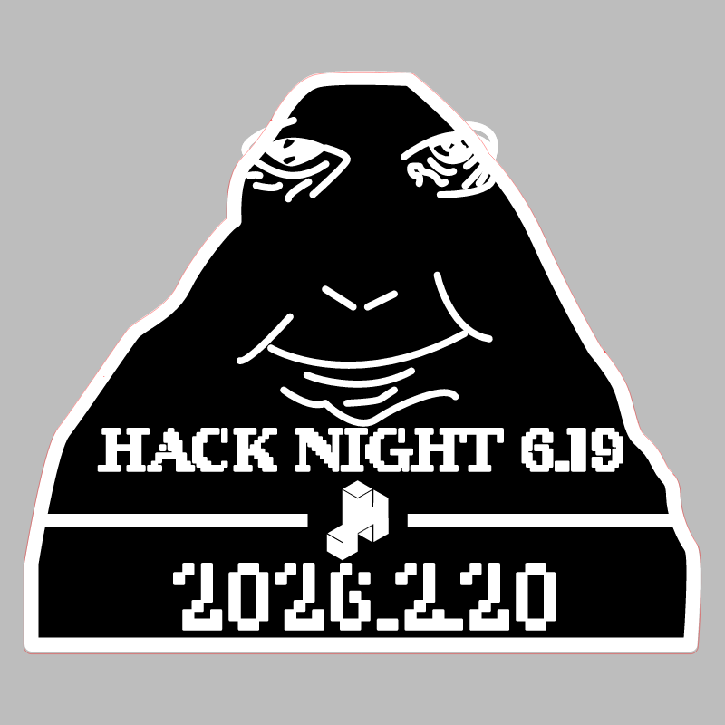

# Hack Night 6.19

CMS event: `170` · slug `6.19`.

Badge and stamp were separated from a shared layout, including the loose correction layers positioned over each design.

## Badge

[Download SVG](badge.svg)

## Stamp

[Download SVG](stamp.svg)

The gray preview background is for visibility and is not part of the SVG. Historical artwork may require corrections before manufacturing. A null reviewer means final approval could not be established.
