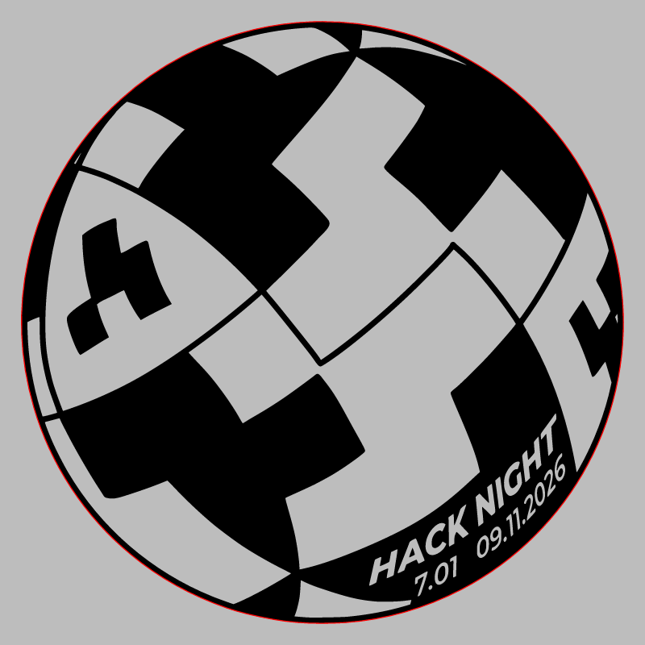
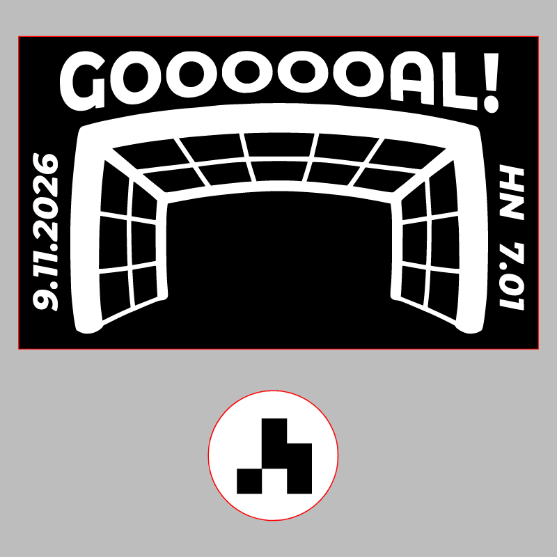

# Hack Night 7.0

CMS event: `196` · slug `7.0`.

The historical artwork prints 7.01. It belongs to CMS Hack Night 7.0; the printed version is preserved.

## Badge

[Download SVG](badge.svg)

## Stamp

[Download SVG](stamp.svg)

The gray preview background is for visibility and is not part of the SVG. Historical artwork may require corrections before manufacturing. A null reviewer means final approval could not be established.
