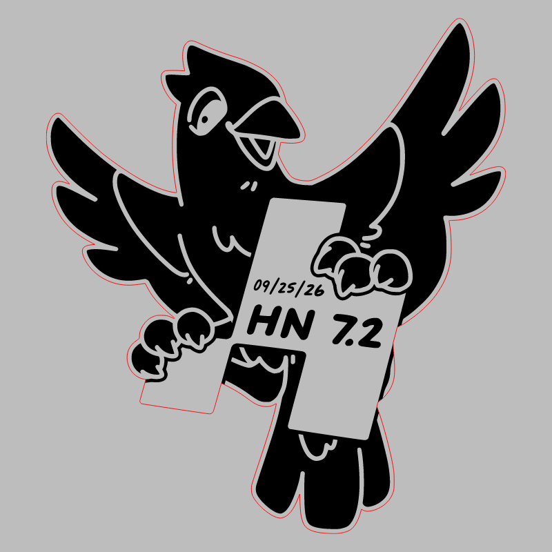
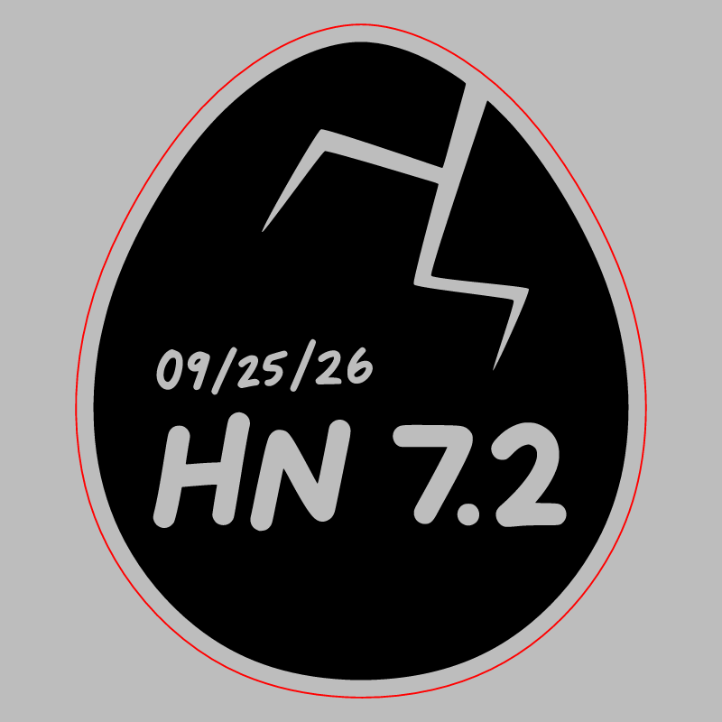

# Hack Night 7.2

CMS event: `211` · slug `7.2`.

The inverted bird and egg are the pair identified for cutting in the source discussion.

## Badge

[Download SVG](badge.svg)

## Stamp

[Download SVG](stamp.svg)

The gray preview background is for visibility and is not part of the SVG. Historical artwork may require corrections before manufacturing. A null reviewer means final approval could not be established.
