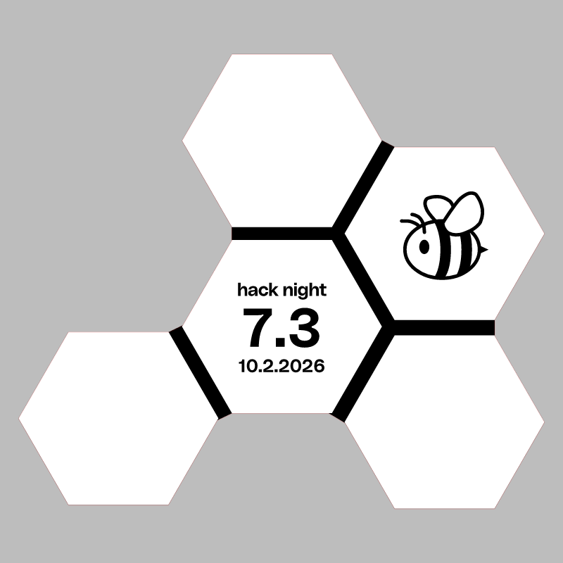
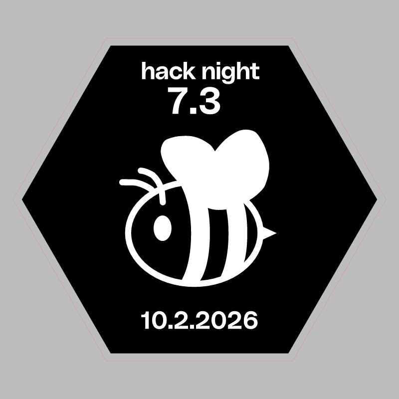

# Hack Night 7.3

CMS event: `212` · slug `7.3`.

An unrelated 7.2 bird nested in the same export was excluded. The bee badge geometry is preserved.

## Badge

[Download SVG](badge.svg)

## Stamp

[Download SVG](stamp.svg)

The gray preview background is for visibility and is not part of the SVG. Historical artwork may require corrections before manufacturing. A null reviewer means final approval could not be established.
