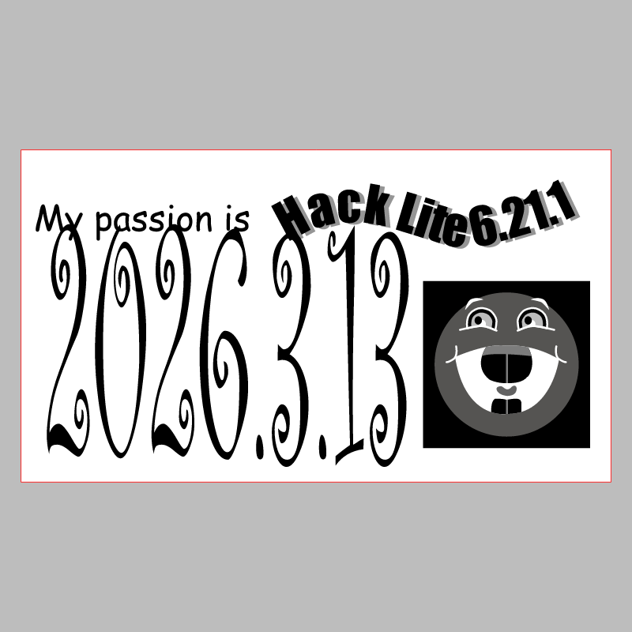
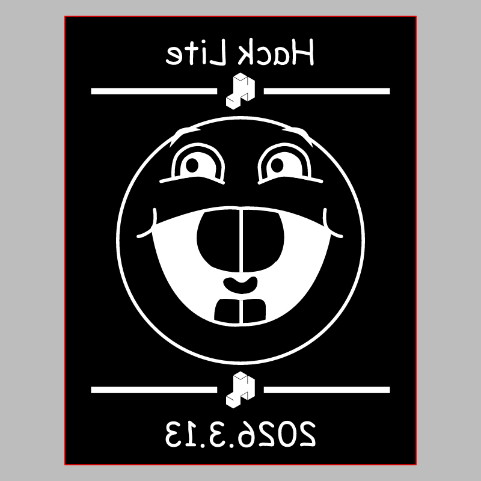

# Hack Lite — 2026

CMS event: `174` · slug `hack-lite-spring-2026`.

The stamp SVG contains an embedded raster image. Its mirrored orientation is preserved from the historical artwork.

## Badge

[Download SVG](badge.svg)

## Stamp

[Download SVG](stamp.svg)

The gray preview background is for visibility and is not part of the SVG. Historical artwork may require corrections before manufacturing. A null reviewer means final approval could not be established.
